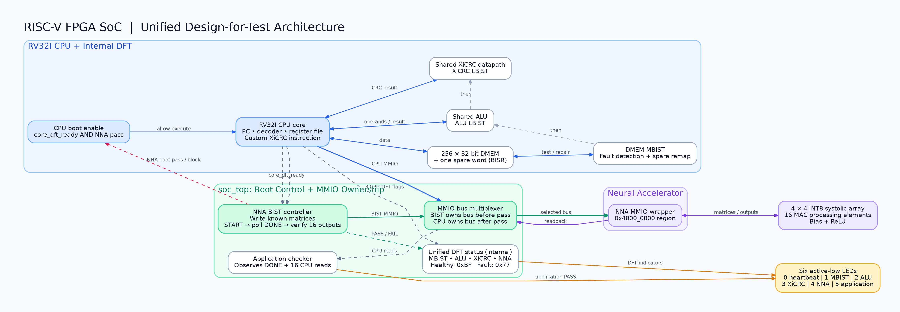
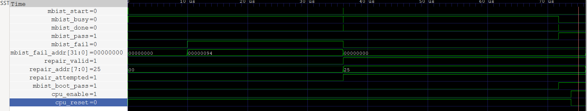
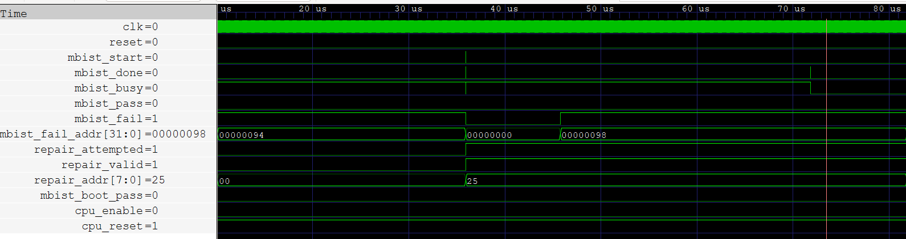
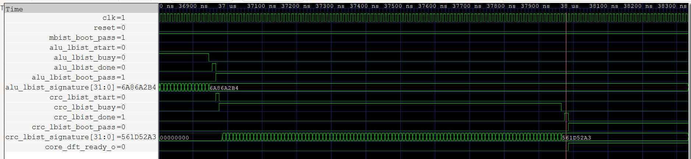
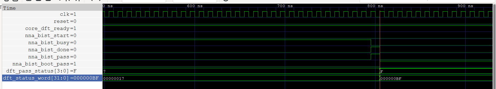
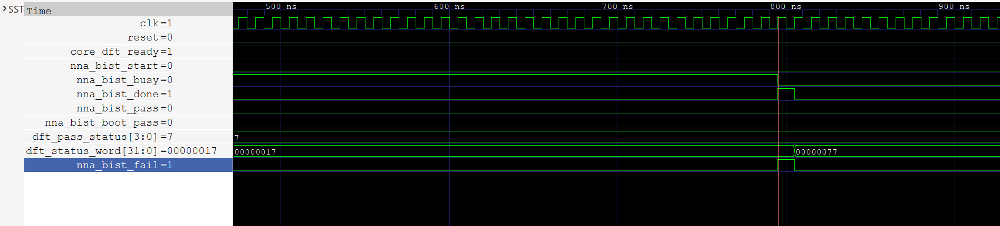
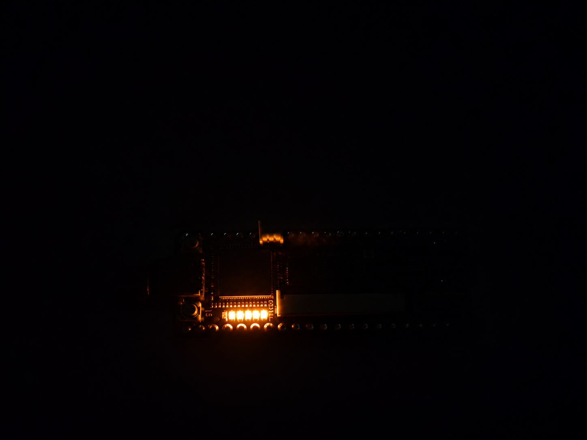
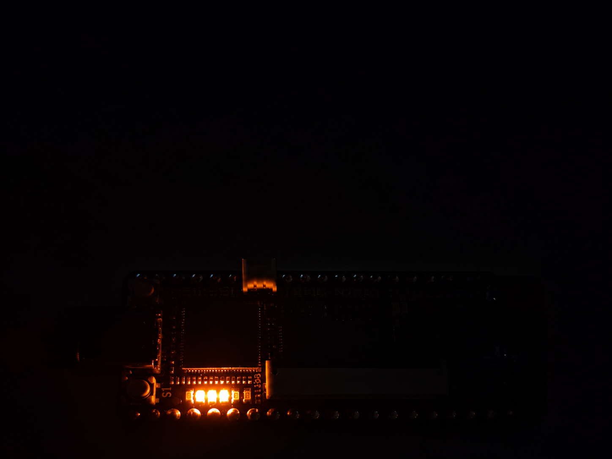
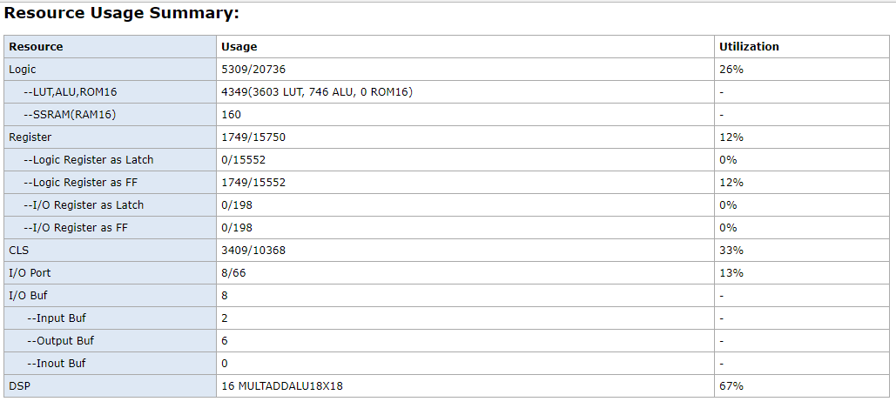
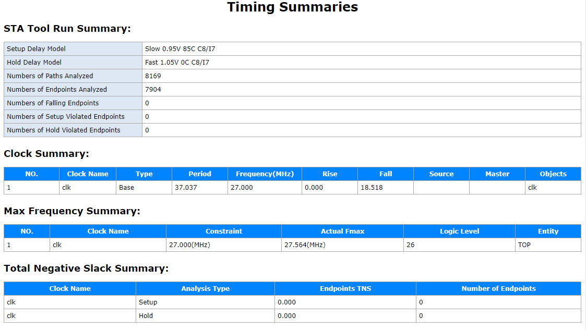

# Custom RISC-V FPGA SoC with 16-PE INT8 Neural Accelerator and Built-In Self-Test

A custom **32-bit single-cycle RISC-V SoC**, integrating a **XiCRC custom instruction**, a **4 × 4 INT8 systolic neural-network accelerator (16 processing elements)**, and a coordinated **design-for-test (DFT) boot sequence**.

The design uses mixed **SystemVerilog, Verilog, and VHDL** RTL and has been implemented on the **Sipeed Tang Nano 20K** with **Gowin EDA**. The FPGA demonstration covers both a healthy startup and a deliberately fault-injected NNA startup that prevents application execution.

## At a glance

| Component | Implementation |
| --- | --- |
| Processor | Custom 32-bit single-cycle RV32I-style core |
| Instruction extension | XiCRC CRC-16 datapath integrated into CPU execution |
| Neural accelerator | 4 × 4 INT8 systolic array; 16 multiply-accumulate processing elements |
| Neural computation | 4 × 4 matrix multiplication, bias addition, ReLU; 16 result readbacks |
| CPU–accelerator interface | Memory-mapped I/O (MMIO) at `0x4000_0000` |
| Built-in tests | DMEM MBIST/BISR, ALU LBIST, XiCRC LBIST, NNA BIST |
| FPGA target | Sipeed Tang Nano 20K / Gowin GW2AR-18 |
| Design clock | 27 MHz |
| Verification | Icarus Verilog, GHDL, GTKWave, Gowin implementation and FPGA LED tests |

## System architecture



The CPU executes firmware stored in its instruction memory. Ordinary load/store instructions access data memory or the NNA's MMIO registers. At startup, self-test logic validates the memory, CPU execution units, and accelerator before the application is allowed to proceed.

**High-level boot path:**

```text
Power-on / reset
      |
      v
DMEM MBIST ---- fault detected? ----> BISR remap to one spare word
      |                                   |
      +<----------- full retest <---------+
      |
      v
ALU LBIST (100 patterns)
      |
      v
XiCRC LBIST (99 patterns)
      |
      v
NNA BIST (16 result comparisons)
      |
      +---- failure ----> CPU application remains blocked
      |
      v
Release CPU application
      |
      v
XiCRC firmware self-test --> configure/start NNA --> poll DONE
      |
      v
Read and check all 16 NNA outputs --> application PASS LED
```

The diagram is a functional overview, not a claim that every internal node is externally observable on the board.

## Processor and XiCRC extension

The CPU is a modular **32-bit single-cycle core**, with a register file, instruction and data memory, decoder, immediate generator, ALU, branch/next-PC logic, and memory-mapped peripheral access.

The **XiCRC** extension is integrated into the CPU instruction execution path rather than exposed as a separate MMIO-only peripheral. The firmware performs a known-answer CRC-16 check before proceeding with its neural-accelerator workload:

```text
Input data:    0x0D
Initial CRC:   0x0000
Expected CRC:  0xD1AD
```

The boot firmware checks the result and does not continue to the NNA application test if it is incorrect. This software-level XiCRC check is distinct from the earlier, hardware-controlled XiCRC LBIST stage.

## INT8 neural-network accelerator

The accelerator contains a **4 × 4 array of 16 INT8 MAC processing elements**, with accumulation, bias addition and ReLU activation. The integrated design performs a **4 × 4 matrix operation** and makes **16 output elements** available for CPU readback.

The accelerator is managed through an MMIO wrapper that provides operand storage, start/status control, and output registers. Its completion indication is latched as a **sticky DONE status**, allowing the CPU to poll it without missing a short completion pulse.

### MMIO integration

- **Peripheral base:** `0x4000_0000`.
- CPU uses its normal `LW` and `SW` load/store paths to access the accelerator.
- Firmware writes accelerator inputs, weights and biases, starts a calculation, polls DONE, and reads back **all 16 results**.
- The 16 output registers occupy **`0x4000_00C0` to `0x4000_00FC`**, at four-byte spacing.

The full current register decode is defined by the RTL in `rtl/nna_mmio_wrapper.vhd` and the CPU firmware in `rtl/cpu/rv32i_imem.sv`. Older four-output register tables and test vectors from the initial MVP should **not** be used as the v2 interface specification.

## Design for test (DFT)

A staged boot controller prevents the CPU application from starting unless the required built-in tests pass.

| DFT block | Test approach | Recorded result |
| --- | --- | --- |
| DMEM MBIST | March-style write/read sweeps over a 256 × 32-bit data memory | Pass in healthy simulation |
| DMEM BISR | One spare 32-bit word and logical-address remapping; complete memory retest | Single injected faulty word repaired in simulation |
| ALU LBIST | 100 pseudo-random test patterns, compacted with a MISR | Signature `0x6A86A2B4` |
| XiCRC LBIST | 99 test patterns, compacted with a MISR | Signature `0x561D52A3` |
| NNA BIST | Known-answer test using an identity-input pattern and 16 output comparisons | Pass in healthy build; fail when a result is deliberately corrupted |

These are **targeted built-in tests**, not a quantified stuck-at fault-coverage analysis or a guarantee of detecting every possible hardware defect.

### Memory repair: one fault versus two

The BISR scheme can redirect **one faulty logical DMEM word** to a spare. In simulation, an injected fault at byte address **`0x94`** (word index 37, `0x25`) is identified, remapped, and followed by a successful full MBIST retest. The CPU subsequently becomes eligible to boot.



With **two distinct injected faulty words** (byte addresses `0x94` and `0x98`), the single spare is insufficient. The second MBIST attempt fails, **`mbist_boot_pass` remains low**, and the CPU remains disabled and in reset.



These two BISR cases were demonstrated by **simulation fault injection**, not by physically damaging FPGA memory.

### ALU and XiCRC logic self-tests

The standalone SystemVerilog CPU testbench shows the 100-pattern ALU LBIST followed by the 99-pattern XiCRC LBIST and the expected final MISR signatures. These tests exercise the CPU's DFT startup path before the application is released.



### Unified DFT startup and NNA fault injection

At the SoC level, the NNA BIST starts after the CPU-side DFT readiness signal. A passing NNA test permits CPU boot; a failing test blocks it.





The simulation-only diagnostic status register is assembled as:

```text
bit 7     NNA BIST boot pass
bit 6     NNA BIST fault latched
bit 5     NNA BIST done latched
bit 4     CPU DFT ready
bits 3:0  {NNA BIST pass, XiCRC LBIST pass, ALU LBIST pass, MBIST pass}
```

| SoC-level simulation | Final diagnostic status | Consequence |
| --- | --- | --- |
| Healthy boot | `0x000000BF` | All required startup tests pass; CPU boot is permitted |
| Injected NNA readback fault | `0x00000077` | NNA BIST fails; CPU application remains blocked |

**Verification boundary:** These *unified SoC-level waveforms* were generated in **GHDL using a VHDL CPU stub** (`tb/rv32i_core_stub.vhd`), not a mixed-language simulation of the full SystemVerilog CPU. The **actual CPU RTL and its DFT sequence were tested separately using Icarus Verilog**, and healthy/fault-injected behaviour was also observed on the physical FPGA. The diagnostic status word shown above was observed in simulation; this revision does not expose it as an external JTAG register.

## FPGA demonstration

The SoC was implemented on the **Sipeed Tang Nano 20K**. The six onboard LEDs are **active-low** and provide a compact indication of the hardware boot path:

| LED | Meaning |
| --- | --- |
| LED0 | Heartbeat (blinking) |
| LED1 | DMEM MBIST passed |
| LED2 | ALU LBIST passed |
| LED3 | XiCRC LBIST passed |
| LED4 | NNA BIST passed |
| LED5 | CPU firmware completed its NNA application checks |

**Healthy configuration:** heartbeat blinks, and LEDs 1–5 indicate pass.



**Fault-injected configuration:** a deliberate readback modification flips one bit of **NNA output 7** during the NNA BIST check. LED0 continues blinking and LEDs 1–3 indicate the earlier tests passed, but LEDs 4–5 do not indicate pass. This demonstrates **boot blocking on a detected accelerator error**; it is a controlled RTL fault-injection build, not a physical chip defect.



The onboard **S1 / KEY1** button is an active-high reset input. Holding it clears the pass indications; releasing it reruns the boot tests.

> **Build safeguard:** The normal/release configuration uses `SIM_INJECT_NNA_FAULT = false`. The injected-fault configuration should be built separately and not left as the default source setting.

## Gowin FPGA implementation

| Metric | Recorded post-route result |
| --- | ---: |
| FPGA | Gowin GW2AR-18 on Tang Nano 20K |
| Clock constraint | 27 MHz |
| Logic resources | 5,309 / 20,736 (about 26%) |
| Flip-flops | 1,749 / 15,750 (about 12%) |
| DSP resources | 16 / 24 (about 67%) |
| Distributed SRAM resources | 160 |
| Block SRAM | 0 / 46 |
| Reported achievable clock | Approximately 27.56 MHz |
| Setup/hold violations | 0 reported for the captured run |

These figures refer to the recorded v2 implementation, **not** the much smaller pre-DFT, four-output MVP figures in earlier documentation. Timing is close to the 27 MHz target, so changes to the RTL or constraints require a fresh place-and-route/timing check.





## Verification scope and tools

| Environment | What was checked |
| --- | --- |
| **Icarus Verilog + GTKWave** | Real SystemVerilog CPU RTL; boot/functional checks; ALU and XiCRC LBIST; MBIST/BISR single-fault repair and two-fault unrecoverable behaviour |
| **GHDL + GTKWave** | VHDL SoC-level NNA BIST controller and boot gating, with the documented VHDL CPU stub |
| **Gowin EDA** | Mixed-language synthesis, placement, routing, timing analysis, FPGA programming |
| **Tang Nano 20K** | Healthy startup LEDs, NNA-fault startup blocking, and reset/restart behaviour |

Relevant testbenches include:

```text
tb/rv32i_core_dft_tb.sv
tb/rv32i_core_bisr_repair_boot_tb.sv
tb/rv32i_core_bisr_unrecoverable_tb.sv
tb/rv32i_core_stub.vhd
```

The included screenshots are verification evidence. Raw `.vcd`, `.ghw`, simulator executables, and transient Gowin build products are intentionally ignored by Git; a clean checkout should regenerate those files locally. **A unified one-command regression script is not yet provided**, and the Gowin project may require adding the repository RTL/constraints to a local tool project before rebuilding.

## Repository layout

```text
RISC-V-NNA-SoC/
├── rtl/                         # CPU, NNA and SoC integration RTL
│   ├── cpu/
│   ├── nna/
│   ├── soc_top.vhd
│   └── nna_mmio_wrapper.vhd
├── dft/                         # MBIST, BISR, LBIST and NNA BIST modules
├── tb/                          # SystemVerilog and VHDL testbenches
├── constriants/                 # Existing FPGA constraints directory name
├── docs/
│   ├── architecture/            # Architectural overview
│   ├── waveforms/               # GTKWave screenshots (not raw traces)
│   ├── hardware/                # Healthy/fault-injected board photographs
│   └── reports/                 # Gowin post-route report screenshots
├── archive/                     # Archived project material
├── .gitignore
└── README.md
```

`build/` contains local, Git-ignored simulator outputs when generated. The `constriants/` spelling reflects the **current directory name**; it can be corrected after checking any project-file and script path references.

## Project evolution and limitations

The original FPGA MVP demonstrated a single-cycle RISC-V CPU, XiCRC execution, MMIO communication and a smaller NNA output test. The current **v2 DFT/CPU upgrade** adds a 16-result NNA workflow, coordinated startup self-tests, simulated single-word memory repair, a documented unrecoverable-memory scenario, and hardware-observed NNA fault blocking.

Current limitations and possible extensions include **automated regression scripts**, clearer synthesis-to-source traceability, a software-visible DFT diagnostic register, broader fault campaigns and quantitative fault coverage, and additional hardware validation. MBIST/BISR repair and the unified GHDL boot sequence should not be represented as physically injected memory failures or a full mixed-language CPU simulation.

## Status

**v2 DFT/CPU upgrade:** CPU and accelerator integration, DFT simulations, Gowin implementation, and healthy/fault-injected board demonstrations have been completed. The screenshots linked above document the observed results. The default healthy RTL configuration should be confirmed before tagging or merging a release.
